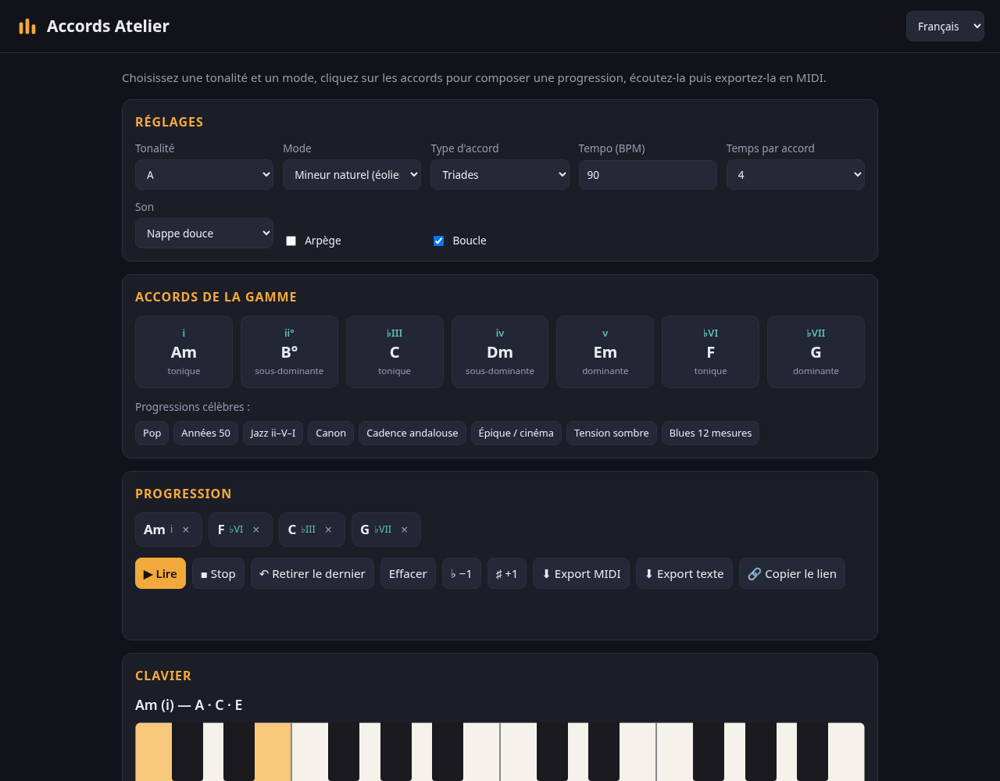
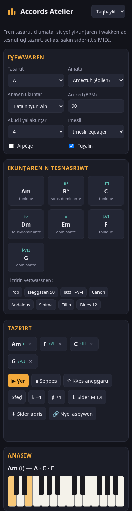

# Accords Atelier

**Construisez, écoutez et exportez des progressions d'accords, directement dans le navigateur.**
Outil gratuit et open source pour musiciens, compositeurs de musique de film et monteurs vidéo. Interface en français, anglais et taqbaylit (kabyle).

🎹 **Démo : https://salimadour31-boop.github.io/accords-atelier/**

## Fonctionnalités

- 12 tonalités et 9 modes : majeur, dorien, phrygien, lydien, mixolydien, mineur naturel, locrien, mineur harmonique, mineur mélodique.
- Accords de la gamme en triades ou en septièmes, avec chiffrage romain (I, ii, ♭VII…) et fonction harmonique.
- Progressions célèbres en un clic : pop, années 50, jazz ii–V–I, Canon, cadence andalouse, épique/cinéma, tension sombre, blues 12 mesures.
- Lecture avec synthé intégré (nappe douce, clavier, pincé), tempo réglable, mode arpège et boucle.
- Clavier de deux octaves qui montre les notes de l'accord joué.
- Transposition d'un demi-ton vers le haut ou le bas.
- Export **MIDI** (à glisser dans un DAW ou un logiciel de montage) et export **texte**.
- Lien partageable : la progression est enregistrée dans l'adresse de la page.

## Utilisation

1. Ouvrez la [démo](https://salimadour31-boop.github.io/accords-atelier/) (ou `index.html` en local, aucune installation).
2. Choisissez la tonalité, le mode et le type d'accord.
3. Cliquez sur les accords pour les ajouter à la progression, ou chargez une progression célèbre.
4. Appuyez sur **▶ Lire**, puis exportez en MIDI ou copiez le lien.

## English

Free browser tool to build chord progressions in any key and mode, hear them with a built-in synth, see the notes on a keyboard, transpose, and export to MIDI or text. No install, no data sent anywhere.

## Version mobile

## Technique

HTML, CSS et JavaScript sans dépendance. Le son est généré avec la Web Audio API ; le fichier MIDI (format 0) est écrit dans le navigateur. Fichiers : `index.html`, `styles.css`, `theory.js` (théorie musicale), `i18n.js` (traductions), `app.js` (interface, audio, export).

## Licence

[MIT](LICENSE)
